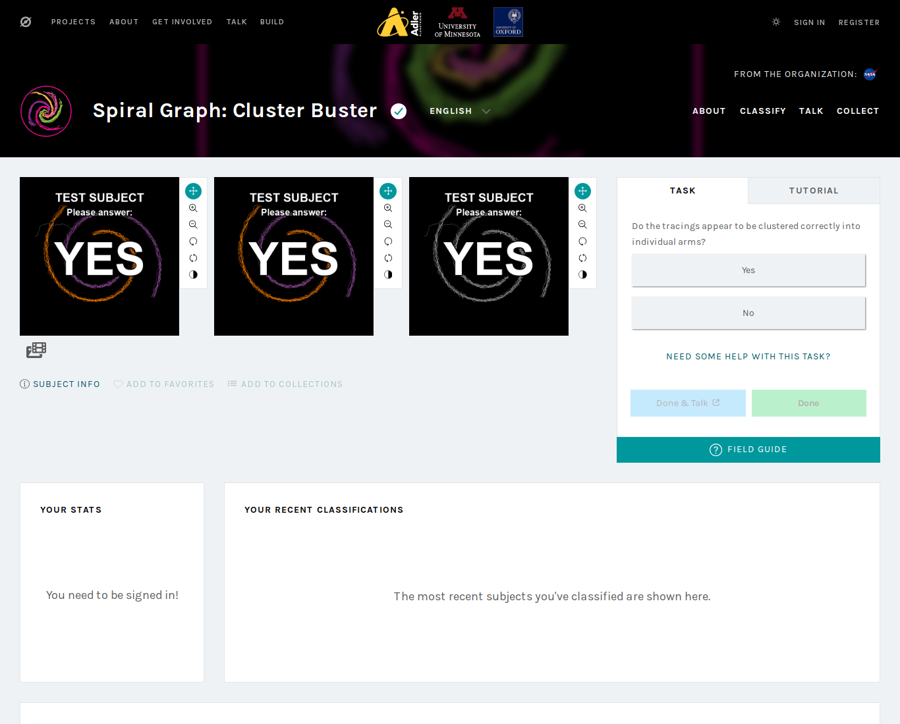

# Deployment: attention-check (captcha) subjects, 2026-07-23

## Summary

Deployed `cluster-buster-qc` — 200 synthetic attention-check subjects
(100 YES / 100 NO) whose images instruct the answer ("TEST SUBJECT —
Please answer: YES/NO" on all three frames). A tripwire against the class of
automated / careless classification seen on 2026-07-12 (see
`2026-07-12-bot-classifications.md`).

*A captcha subject (`qcyes001`) as served by the live classifier — three
frames in row mode, instruction on each, real Yes/No task panel.*

## Facts

- Subject set: `cluster-buster-qc`, id **137851**, project 23492.
- Uploaded 2026-07-23: 200 subjects, 0 failed (via `zooniverse_upload.py`).
- Linked to workflow **26736** the same day: workflow went 126 -> **127**
  linked sets, `subjects_count` 62,503 -> 62,703.
- Serving verified pooled-random before deploy: in 80 consecutive
  classifications a real volunteer spanned 50-60 distinct sets, changing set
  on 95-100% of consecutive pairs — captchas are drawn uniformly into every
  volunteer's stream at ~0.38%.
- Answer ground truth: gid prefix `qcyes###` / `qcno###` and
  `#data_set=attention_check`; the committed `captcha_subjects.json` maps each
  Panoptes subject id to its expected answer.
- Checker bookmark (`captcha_check.py`) primed at/around link time via a full
  history harvest, so post-link captcha answers are the first recorded hits.
  Exact `last_id` is in the gitignored `state/captcha_check_state.json`.

## Exclusion rule (must hold for all downstream science)

Every label aggregation MUST drop the subject ids in `captcha_subjects.json`
(equivalently `#data_set == "attention_check"` / gid prefix `qc`), and
down-weight or exclude accounts flagged in `incidents/*captcha-flags*.json`,
in addition to the known bot user 3055564.

## Operations

- Monitor: `captcha_check.py` (manual, read-only) — per-user pass/fail
  verdicts + live-pool count; exit 3 on new FLAG accounts;
  `--write-incident` emits a dated flags record.
- Keep-alive: captchas retire at 15 votes like any subject; when the live
  count drops, `captcha_check.py --unretire` re-arms the pool (operator,
  interactive confirmation).
- NEVER upload/refresh this set with `upload_set.py` (its hyperparameter
  guard aborts on the empty knob columns) — use `zooniverse_upload.py`.

## Volunteer Talk post (paste to the project Talk board)

> You may occasionally see an obvious test image that says
> "TEST SUBJECT — please answer YES" (or NO). These are attention checks we
> added after an automated account submitted thousands of junk classifications
> in July. Please just answer what the image tells you — they are excluded
> from the science and only help us confirm real classifications. Thanks for
> your patience and for all your help!
